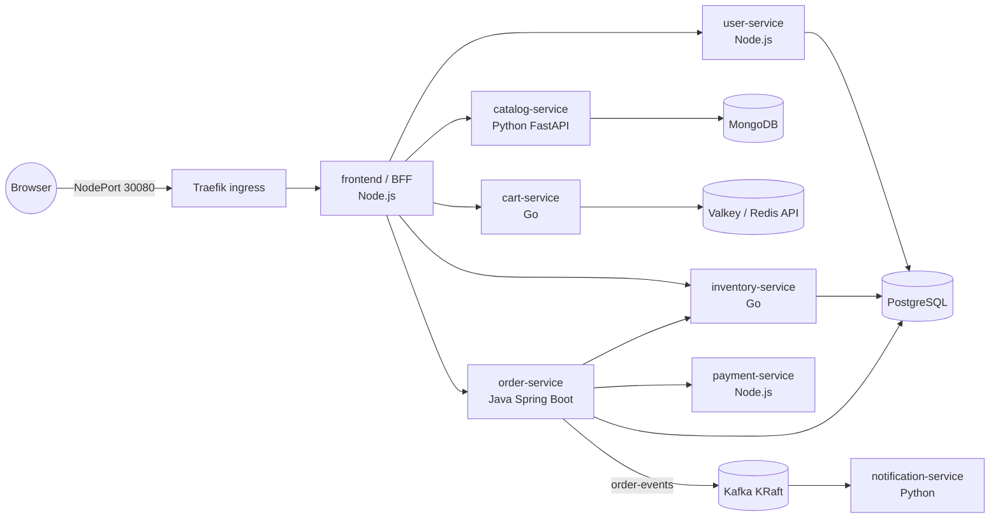

# Jhanvi Trends — microservices e-commerce on kubeadm, with full observability

A marketplace-style online store (catalog, search, cart, checkout, orders, accounts) built as 8 polyglot
microservices, deployed with Helm + Argo CD, and wired for metrics, logs and traces end to end.



| Service | Language | Data | What it does |
|---|---|---|---|
| frontend | Node.js 22 / Express 5 | – | Storefront SPA + Backend-for-Frontend; only service behind the ingress; verifies JWTs |
| user-service | Node.js | PostgreSQL `users` | Register, login (bcrypt + JWT) |
| catalog-service | Python 3.13 / FastAPI | **MongoDB** `catalog` | Products, search, categories, generated product images |
| cart-service | Go 1.25 | **Valkey** (Redis-compatible) | Per-user carts (hash per user, 30-day TTL) |
| inventory-service | Go | PostgreSQL `inventory` | Stock levels, all-or-nothing reservations |
| order-service | Java 21 / Spring Boot 3.5 | PostgreSQL `orders` | Checkout saga: reserve → pay → save → commit, publishes to **Kafka** |
| payment-service | Node.js | – | Mock gateway with runtime chaos knobs (decline rate, latency) |
| notification-service | Python | – | Kafka consumer for `order-events`, "sends" emails |
| loadgen | Python / Locust | – | Synthetic shoppers so dashboards always have data |

### Observability stack

| Signal | Path |
|---|---|
| Metrics | Every service exposes `http_server_requests_seconds` (same name/labels in all 4 languages) + business metrics → ServiceMonitors → **Prometheus** |
| Traces | OpenTelemetry SDK/agent per language → node-local **OTel Collector** (DaemonSet, hostPort 4317) → **Tempo**. Trace context crosses Kafka in record headers, so one checkout = one trace across 6 services |
| Logs | JSON on stdout with `trace_id` → OTel Collector `filelog` → **Loki** (native OTLP) |
| Correlation | Grafana: log line → trace (derived field), span → logs, span → metrics, Tempo service graph from metrics-generator |
| Alerts | PrometheusRules: error ratio, p95 latency, payment declines, no orders, Kafka consumer lag, low stock, pod restarts |
| Dashboard | **Jhanvi Trends / Service Overview**: business KPIs, RED per service, domain metrics, Kafka/Postgres/Mongo/Redis, resources, error logs |

Exporters: postgres-exporter, mongodb_exporter, redis_exporter (works with Valkey), kafka-exporter.

## Repository layout

```
services/<name>/            source + Dockerfile for each service
deploy/charts/jhanvi-trends/    Helm chart: services, PostgreSQL, MongoDB, Redis, Kafka, ingress, rules, dashboard
deploy/platform/            values for kube-prometheus-stack, Loki, Tempo, OTel Collector, Traefik, metrics-server
deploy/argocd/              AppProject, app-of-apps root, one Application per component
.github/workflows/ci.yaml   build → Trivy scan → push to Docker Hub → bump image tags in Git
scripts/                    configure.sh, bootstrap.sh, gen-dashboard.py
```

## Prerequisites

- Your kubeadm cluster on GCE with a working CNI (Calico/Flannel both support the `hostPort` used by the OTel Collector).
- Worker capacity: roughly **6 vCPU / 12 GB RAM** free across workers for app + platform (e.g. 2 × e2-standard-4).
- `kubectl` and `helm` on the machine you bootstrap from.
- A GitHub repo for this code (Argo CD reads it) and a Docker Hub account for the images.

## Deploy

**1. Fill in the placeholders and push**

```bash
./scripts/configure.sh <github-owner> <dockerhub-namespace> <EXTERNAL_IP_OF_A_WORKER_NODE>
git add -A && git commit -m "Configure for my cluster" && git push
```

**2. Build the images to Docker Hub**

1. Docker Hub → **Account settings → Personal access tokens → Generate new token** with
   *Read, Write, Delete* access.
2. GitHub repo → **Settings → Secrets and variables → Actions → New repository secret**:
   `DOCKERHUB_USERNAME` (your Docker Hub username) and `DOCKERHUB_TOKEN` (the token).
   To push to a Docker Hub organization instead, also add a repository **variable** `DOCKERHUB_NAMESPACE`.
3. GitHub repo → **Settings → Actions → General → Workflow permissions → Read and write** (CI commits image tags).
4. **Actions → ci → Run workflow**. It builds 9 images to `docker.io/<namespace>/jhanvi-trends-*` and commits the
   new tags into `deploy/charts/jhanvi-trends/values.yaml`. New Docker Hub repositories are public by default;
   if yours are private, use the pull secret in step 3.

**3. Bootstrap the cluster** (installs local-path StorageClass, secrets, Argo CD, app of apps)

```bash
./scripts/bootstrap.sh
# private images or pull limits:  DOCKERHUB_USER=<you> DOCKERHUB_TOKEN=<read-only access token> ./scripts/bootstrap.sh
#   then set global.imagePullSecrets: [{name: dockerhub-pull}] in the chart values and push
# private repo:    GIT_USER=<you> GIT_TOKEN=<PAT> ./scripts/bootstrap.sh
kubectl -n argocd get applications -w
```

Argo CD syncs in waves: kube-prometheus-stack + metrics-server → Traefik, Loki, Tempo → OTel Collector → Jhanvi Trends.

**4. Open the firewall for the NodePorts**

```bash
gcloud compute firewall-rules create jhanvi-trends-ingress \
  --network <your-vpc> --allow tcp:30080,tcp:30443 \
  --target-tags <worker-network-tag> --source-ranges <your-public-ip>/32
```

| | URL | Login |
|---|---|---|
| Shop | `http://shop.<IP>.nip.io:30080` | register in the UI |
| Grafana | `http://grafana.<IP>.nip.io:30080` | `admin` / `kubectl -n monitoring get secret grafana-admin -o jsonpath='{.data.admin-password}' \| base64 -d` |
| Argo CD | `http://argocd.<IP>.nip.io:30080` | `admin` / `kubectl -n argocd get secret argocd-initial-admin-secret -o jsonpath='{.data.password}' \| base64 -d` |

nip.io resolves `anything.<IP>.nip.io` to `<IP>`, so no DNS setup is needed. For a real domain + HTTPS,
put a GCP HTTP(S) load balancer (instance group on port 30080) in front, or add cert-manager.

## Things to try once it's running

**Follow one checkout across every service.** Place an order in the UI → Grafana → Explore → Tempo →
Search, service `order-service` → open the trace: frontend → order → inventory → payment → Kafka →
notification, plus every SQL/Redis/Mongo call. Click *Logs for this span* to jump to Loki.

**Break payments and watch the alert fire.**

```bash
kubectl -n jhanvi-trends port-forward deploy/payment-service 8080:8080 &
curl -XPOST localhost:8080/chaos -H 'content-type: application/json' -d '{"failureRate":0.5,"latencyMs":1200}'
```
Within ~5 minutes: checkout success drops on the dashboard, `JhanviTrendsPaymentDeclineSpike` fires, the
Tempo service graph shows payment-service in red. Reset with `{"failureRate":0.05,"latencyMs":150}`.

**Stop the consumer and watch Kafka lag grow.**

```bash
kubectl -n jhanvi-trends scale deploy/notification-service --replicas=0   # lag climbs on the dashboard
kubectl -n jhanvi-trends scale deploy/notification-service --replicas=1   # it catches up from its offset
```

**Useful queries**

```promql
# p95 latency per service
histogram_quantile(0.95, sum by (job, le) (rate(http_server_requests_seconds_bucket{namespace="jhanvi-trends"}[5m])))
# orders confirmed per minute
sum(rate(orders_placed_total[5m])) * 60
# notification consumer lag
sum(kafka_consumergroup_lag{consumergroup="notification-service"})
```
```logql
{k8s_namespace_name="jhanvi-trends", service_name="order-service"} | json | level=~"WARN|ERROR"
```

## Day-2 notes

- **Releases**: push to `main` → CI builds only changed services → commits new tags → Argo CD rolls them out.
  Roll back with `git revert` of the tag-bump commit.
- **Secrets** live in `jhanvi-trends/jhanvi-trends-secrets` (created once by bootstrap). For a real setup move them to
  Sealed Secrets or External Secrets + GCP Secret Manager.
- **Datastores** are single-replica StatefulSets on `local-path` (node-local disk). Good for learning; for
  production use the GCE PD CSI driver (`pd.csi.storage.gke.io`) or managed services (Cloud SQL, MongoDB Atlas,
  Memorystore, Confluent/Strimzi Kafka with 3 brokers).
- **Control-plane metrics**: kubeadm binds controller-manager/scheduler/etcd metrics to 127.0.0.1. To scrape them,
  set `--bind-address=0.0.0.0` (and `--listen-metrics-urls=http://0.0.0.0:2381` for etcd) in
  `/etc/kubernetes/manifests/*.yaml`, then enable those components in `deploy/platform/kube-prometheus-stack.yaml`.
- **Alert delivery**: add a Slack/email receiver under `alertmanager.config` in the same file.
- **Turn off load generation**: set `loadgen.enabled: false` in the chart values.
- **Go dependencies**: the Go Dockerfiles run `go mod tidy` to resolve deps. For reproducible builds run
  `go mod tidy` locally in `services/cart-service` and `services/inventory-service` and commit `go.sum`.
- **Dashboard edits**: change `scripts/gen-dashboard.py` and re-run it, or edit in Grafana and export the JSON
  over `deploy/charts/jhanvi-trends/dashboards/jhanvi-trends-overview.json`.

## Licensing and trademarks

- **This repo** is MIT-licensed (`LICENSE`), copyright © 2026 Bhumaji Systems. Change it before publishing if you want different terms.
- **Third-party software** is listed with its license in `THIRD_PARTY_NOTICES.md`. Every library compiled into
  the services is under a permissive license (MIT, Apache-2.0, BSD, ISC, MPL-2.0 for unmodified files, LGPL-2.1 for
  Hibernate/Logback used as unmodified libraries). Cart storage uses **Valkey** (BSD) rather than Redis 8.
- **Servers you run but don't ship**: MongoDB Community is SSPL and Grafana/Loki/Tempo are AGPL-3.0. Running them
  unmodified for your own shop is fine; their copyleft terms bite only if you modify them and offer them to others,
  or (SSPL) sell MongoDB itself as a hosted service. If you ever plan that, swap MongoDB for FerretDB (Apache-2.0,
  Mongo wire protocol) or a hosted database.
- **Brand and content**: the store's look, logo, wording, product names, brands and book titles are original to
  this project and fictional. It is not affiliated with or modelled on any real retailer's branding. Product
  images are generated SVGs; no stock photos, fonts or icon packs are bundled.
- **Before commercial use**, search the name "Jhanvi Trends" (and any brand you add) in the
  [IP India trademark search](https://tmrsearch.ipindia.gov.in/) and the
  [WIPO Global Brand Database](https://branddb.wipo.int/). Store names are commonly registered, so rename if there's a
  conflict in your market.
- **CI guards**: pull requests run GitHub's dependency review, which fails if a new dependency is GPL/AGPL/SSPL, and
  every image build prints a Trivy license report.

## Local development

Each service runs on its own (`npm start`, `uvicorn app.main:app`, `go run .`, `mvn spring-boot:run`) and reads
its config from environment variables: `PG*`, `MONGODB_URI`, `REDIS_ADDR`, `KAFKA_BOOTSTRAP_SERVERS`,
`*_SERVICE_URL`, `JWT_SECRET`, `OTEL_*` — see `deploy/charts/jhanvi-trends/values.yaml` for the full set per service.
